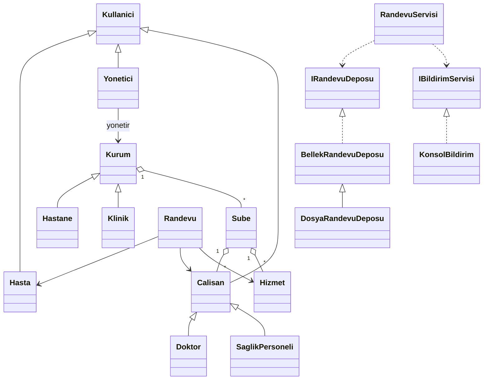

# Hastane / Klinik Randevu Sistemi

Nesneye Dayalı Programlama dönem ödevi (Seçenek A). C# / .NET 8 konsol uygulaması.

## Çalıştırma
```
dotnet run --project RandevuSistemi          # etkileşimli menü
dotnet run --project RandevuSistemi -- --demo # otomatik senaryo
```

## OOP yapısı
- **Kalıtım:** `Kullanici` -> `Hasta`, `Yonetici`, `Calisan` (-> `Doktor`, `SaglikPersoneli`); `Kurum` -> `Hastane`, `Klinik`
- **Çok biçimlilik:** rol menüleri ve onay yetkisi her sınıfta farklı (`RandevuOnaylayabilir`, `MenuBasligi`)
- **Interface:** `IRandevuDeposu`, `IBildirimServisi`
- **Kapsülleme:** `private` listeler, `IReadOnlyList` ile dışa açma, `internal` durum değişimi

## Sınıf diyagramı


## Özellikler (ödev gereksinimleri)
| Gereksinim | Karşılığı |
|---|---|
| Hastane/klinik tanımlama (yetki çerçevesinde) | Sistem yöneticisi yeni hastane/klinik ekler; kurum yöneticisi yalnızca kendi kurumunu yönetir (`Yonetici.YonetebilirMi`) |
| Çok şubeli yapı | `Kurum` -> `Sube`; her şubenin kendi çalışma saatleri, bölümleri, hizmetleri, çalışanları var |
| Hizmetler (süre ve ücret) | `Hizmet` sınıfı; yönetici menüsünden eklenir |
| Çalışan yönetimi | Doktor/sağlık personeli kaydı, uzmanlık/unvan, hizmet atama, uygunluk saatleri |
| Randevu + çakışma kontrolü | `RandevuServisi.Olustur`: hizmet, şube saati, doktor uygunluğu, doktor ve hasta çakışması |
| Randevu detayı kaydı | Randevu nesnesi + `randevular.csv` dosyasına otomatik kayıt (işlem, süre, ücret, çalışan, tarih/saat, durum) |
| Onay mekanizması | Randevu "Beklemede" başlar; doktor (kendi randevusu) veya yetkili yönetici onaylar/reddeder |
| Kullanıcı rolleri | Hasta, Doktor/Sağlık Personeli, Yönetici (kurum ve sistem düzeyinde) |

## Randevu kuralları
1. Çalışan seçilen hizmeti sunmalı.
2. Geçmişe randevu alınamaz.
3. Şube o saatte açık olmalı.
4. Doktor o saatte müsait olmalı (uygunluk aralığı).
5. Doktorun ve hastanın başka aktif randevusuyla çakışma olmamalı.
6. Onay/ret/iptal yalnızca yetkili kişiler tarafından yapılır (hasta kendi randevusunu iptal edebilir).

## Örnek kullanıcılar
Uygulama örnek veriyle açılır: sistem yöneticisi, hastane yöneticisi, klinik yöneticisi, 5 çalışan, 2 hasta.
Menüden "K" ile yeni hasta kaydı yapılabilir.
